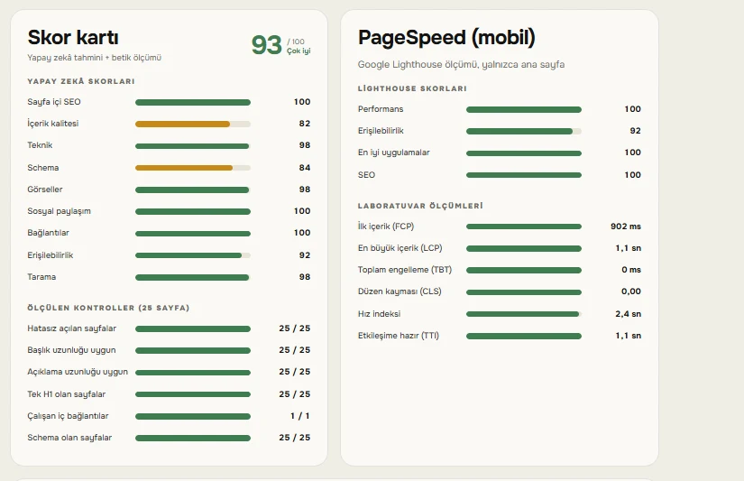
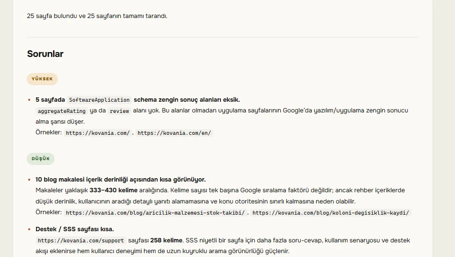
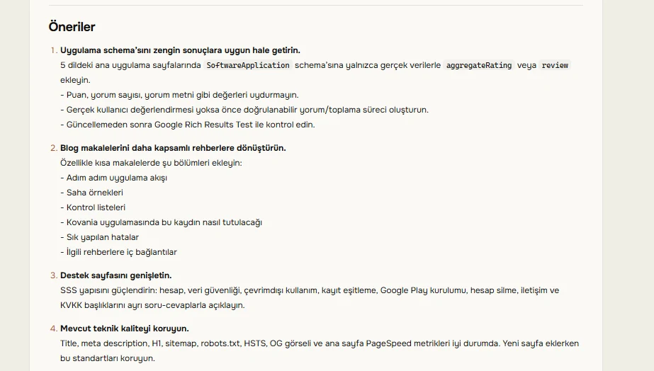
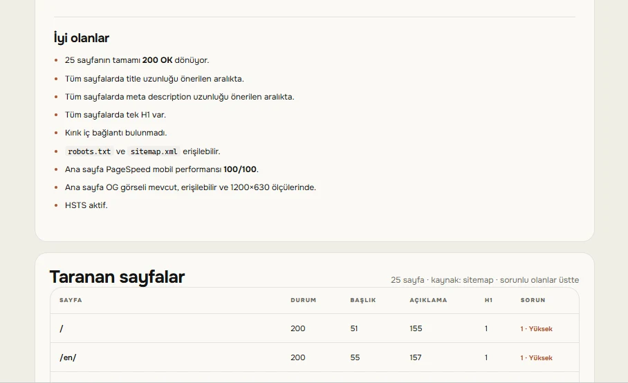
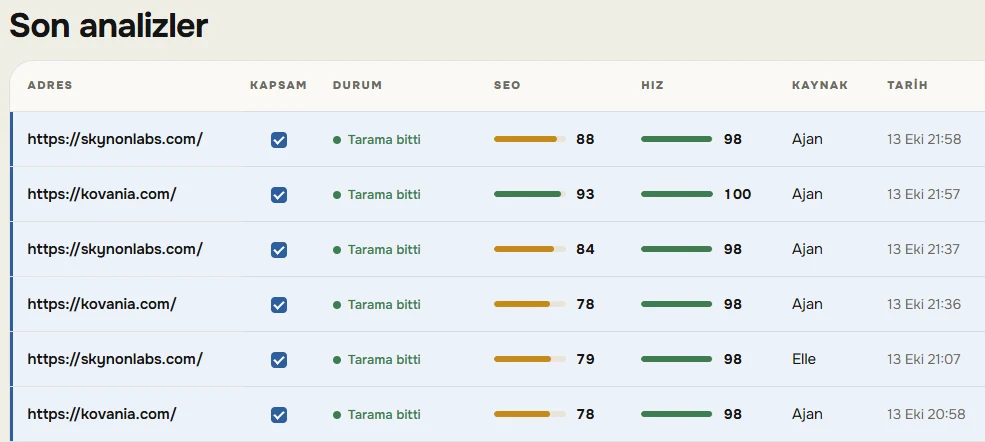
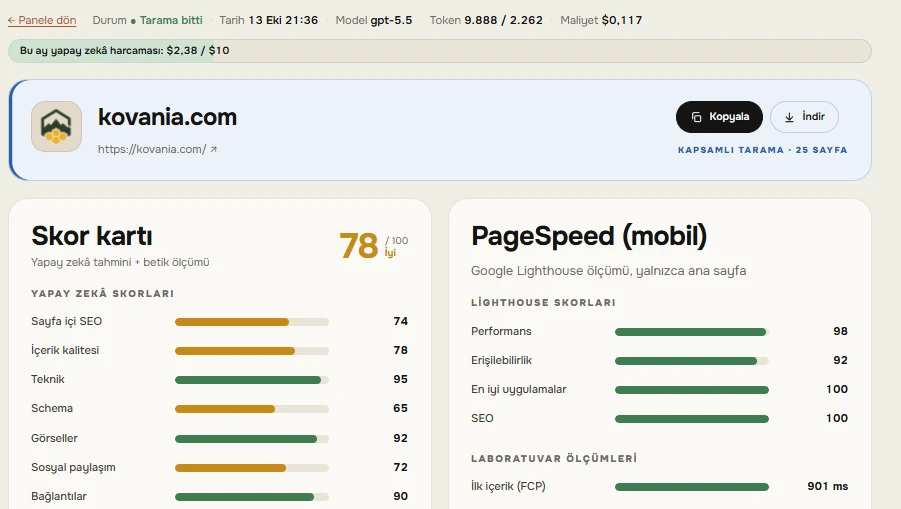
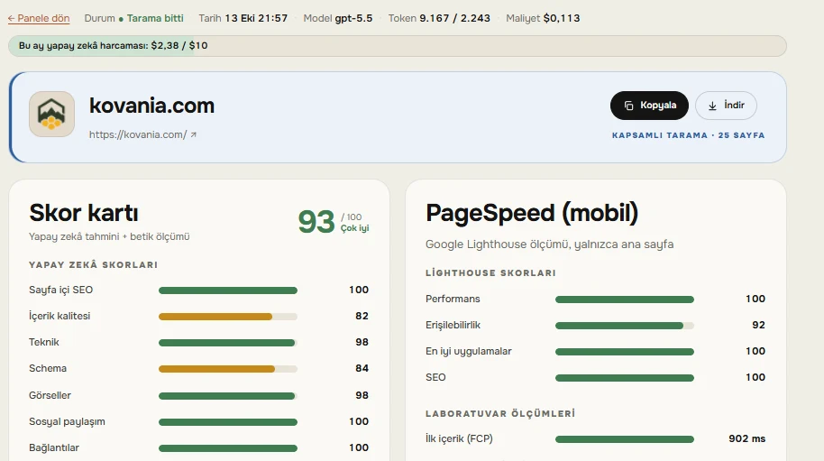
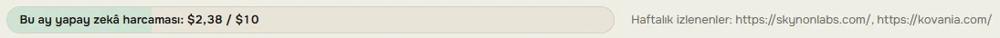
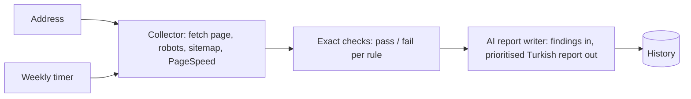

# Skynon SEO — showcase

Internal SEO panel of Skynon Labs. Type an address; the panel crawls the page, runs exact, measurable checks, asks an AI model to write a prioritised report in Turkish, and keeps the history. A weekly list of sites is re-analysed automatically every Monday morning.

[Türkçe](README.tr.md)

> Showcase only. The panel is for in-house use, behind a login, and its source code is private.

| | |
|---|---|
|  |  |
|  |  |

## Result

On kovania.com the panel found missing rich-result fields, thin pages and on-page issues; after the fixes the site-wide SEO score went from **78 to 93**, with mobile PageSpeed performance at 100. On skynonlabs.com the same loop took the score from 79 to 88.

| Before (78) | After (93) |
|---|---|
|  |  |

On-page SEO 74 → 100, schema 65 → 84, social sharing 72 → 100, mobile performance 98 → 100.

## Cost tracking

Every run records the model, tokens used and its cost; a monthly bar shows AI spending against the budget, next to the list of weekly-monitored sites. A typical analysis costs about $0.11–0.17.

## Built on

Page collection builds on an open-source SEO audit toolkit (MIT) that was installed and then extended. The panel itself, the exact checks, the scoring, the report pipeline and model choice, the weekly runs, the budget cap and the Markdown export are Skynon's own work.

## What it checks

- **On-page:** title and description length, H1 count, canonical, noindex, Open Graph and the real pixel size of the share image, Twitter card.
- **Images and links:** file size, alt text, width/height attributes, links without an accessible name.
- **Structured data:** required fields for Google rich results (SoftwareApplication, Product, Article, Organization, LocalBusiness, Event…) and deprecated schema types.
- **Site level:** http → https and www redirects, robots.txt, sitemap and whether the page is in it, llms.txt, HSTS.
- **Speed (optional):** mobile PageSpeed — LCP, CLS, accessibility.

## Architecture

- Python service behind a password-protected reverse proxy; analysis history in SQLite.
- Measurable things are decided by code, not by the model; the model only explains and prioritises the findings.
- Cost per analysis tracked (model, tokens, $); monthly spending cap: when the budget is reached the panel keeps collecting data but stops calling the model.
- Score card coloured by grade (Weak, Fair, Good, Very good), PageSpeed metrics as bars, live progress screen showing the real analysis stages, report export as Markdown.
- Command-line entry point so the same analysis can be run from scripts.

© 2026 Skynon Labs Ltd. All rights reserved. · hello@skynonlabs.com
